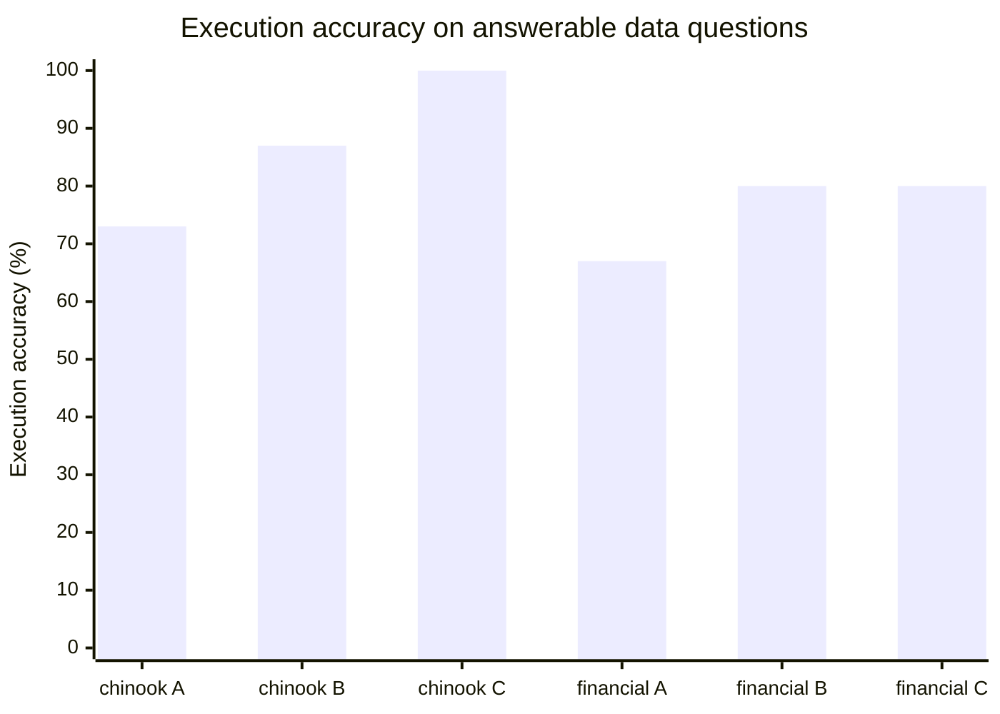

# SchemaSage

LLM-based database documentation, schema discovery and text-to-SQL over SQLite.

SchemaSage reads an SQLite database, profiles its data, builds a relationship
graph (declared foreign keys plus inferred candidates you can accept or reject),
and serves all of it through a FastAPI backend and a Streamlit UI.

## Requirements

- Python 3.12+
- [uv](https://docs.astral.sh/uv/)
- `make` (preinstalled on macOS and most Linux distributions)

Without uv: `pip install -r requirements.txt` (exported with `uv export --no-hashes --no-emit-project -o requirements.txt`).

## Quick start

```bash
make install                               # install dependencies
echo 'OPENAI_API_KEY=sk-...' >> .env       # the Docs step calls the OpenAI API
make dev                                   # start the API and the UI together
```

Put the key in `.env` before `make dev`: the API reads it at startup, and without it the
Docs step of **Run all steps** fails (the other steps still finish).

Then open http://localhost:8501. In **Management**, register `data/chinook.db`
(the sample database in the repo), then press **Run all steps** on the Home page.
Review, edit and export the table descriptions in Management · Documentation.
The **Explorer** page then browses tables and runs read-only queries in its SQL tab.
The **Chat** page answers questions about the database.

`make dev` runs both servers in one terminal and Ctrl-C stops both. To run them
in separate terminals, use `make api` and `make ui`.

## Make targets

| Target | What it does |
|--------|--------------|
| `make install` | Install dependencies (`uv sync`) |
| `make dev` | Start the API and the UI together |
| `make api` | Start the API at http://127.0.0.1:8000, interactive docs at `/docs` |
| `make ui` | Start the Streamlit UI at http://localhost:8501 |
| `make test` | Run the test suite |
| `make data` | Download more sample databases, for example `make data TIER=easy` |
| `make help` | List the targets |

`make data` needs `data/download.sh`, which is not tracked in git.

## Configuration

Set these as environment variables or in a `.env` file at the repo root.

| Variable | Default | Meaning |
|----------|---------|---------|
| `SCHEMASAGE_APP_DB` | `app.db` | SQLite file for the app state (registered databases, runs, relationships) |
| `SCHEMASAGE_DATA_DIR` | `data` | Only databases inside this folder can be registered |
| `SCHEMASAGE_API_URL` | `http://127.0.0.1:8000` | Where the UI finds the API |
| `SCHEMASAGE_EXPORT_DIR` | `docs` | Where Export Markdown writes `tables/<Table>.md` and `schema_overview.md` |
| `OPENAI_API_KEY` | none | OpenAI API key; the Docs step needs it |
| `LANGFUSE_PUBLIC_KEY`, `LANGFUSE_SECRET_KEY` | none | Set both to trace every LLM call (docs, agent, benchmark) to Langfuse |
| `LANGFUSE_BASE_URL` | `https://cloud.langfuse.com` | Langfuse server, e.g. `https://us.cloud.langfuse.com` or a self-hosted URL |

The SQL row limit, query timeout, LLM model, reasoning effort and token prices are set in Management · Settings (stored in app.db).

## Command-line tools

```bash
uv run python -m core.parser data/chinook.db    # schema model as JSON
uv run python -m core.profiler data/chinook.db  # data profile as JSON
```

## Project layout

```
core/                 pipeline logic, no HTTP and no UI
  parser.py           DDL to JSON data model
  profiler.py         data profile, masking, FK candidates
  graph.py            relationship graph and JOIN paths
  sqlite.py           read-only connections, identifier quoting
  sql_guard.py        SQL guard: SELECT only, LIMIT, timeout, masking
  documentation.py    LLM table documentation prompts, validation, export
  evaluation.py       benchmark contexts (A, B, C), answer scoring, metrics
  agent.py            chat agent: tool loop, evidence, repair retry
api/                  FastAPI app
  main.py config.py   app and settings
  routes/             HTTP routes: databases, pipeline, relationships, tables, sql, settings, docs, benchmark, chat
  payloads.py         request and response models
  appdb.py            app.db access
  jobs.py             runs pipeline steps in the background
  llm.py              OpenAI client
ui/                   Streamlit UI
  main.py             entry point: theme, sidebar, navigation
  api_client.py       HTTP client for api/
  views/              pages: home, pipeline, explorer, chat, management (+ management_tabs/)
  markup.py           HTML builders and formatters
  widgets.py          Streamlit pieces shared by several pages
  network.py          pyvis relationship graph
  theme.py design/    design tokens
benchmark/            questions.jsonl, gold.sql, results.csv (written by the benchmark run)
tests/                pytest suite mirroring core/, api/ and ui/
data/                 sample databases (only chinook.db is in git)
```

The pipeline runs parse, then profile, then graph, then docs. `api/` calls the
`core/` functions; the UI reaches them only over HTTP. App state lives in `app.db`, separate from the databases
being analysed.

## Demo

The six demo steps of the project plan, all in the UI.

### Preparation (once, before the demo)

Chinook has only declared foreign keys, so it has no suggestion to accept. formula_1 has one.
The Benchmark tab shows the last benchmark run stored in app.db, not `benchmark/results.csv`.

1. Run `data/download.sh hard` (fetches formula_1), then `make dev` and open http://localhost:8501.
2. Management · Databases · Register a path: `data/chinook.db`, then
   `data/bird/formula_1/formula_1.sqlite` with display name `formula_1`.
3. Select `formula_1` in the sidebar. On the Pipeline page, run parse, profile and graph (Docs is not needed).
4. Select `chinook`, run Management · Benchmark · **Run benchmark (A / B / C)**. It takes a few
   minutes and costs about $0.06.

### Steps

1. **Pipeline (chinook).** Press **Run all steps**. Show the step statuses and durations, the stats
   (11 tables, 64 columns, 11 FKs), the run log and the graph (declared edges in blue).
2. **Management.**
   - Accept a suggestion: select `formula_1`, open Relationships, set Status to `proposed`, press
     **Accept** on `pitStops (raceId, driverId, lap) → lapTimes`. Open the Change log to show who, when and what.
   - Add a manual relationship (chinook): New relationship, `Invoice.BillingCountry` →
     `Customer.Country`. The Value match panel shows 100%. Cardinality `N:M`, a note, **Save**.
     Optionally enter `Customer.Country` → `Employee.Country` without saving: Employee has only
     Canada, so the low-match warning appears.
   - Fix a description: Documentation, table `MediaType`, edit the summary or a column, **Save**, then **Approve**.
3. **Chat, schema question with a path.** `How do I get from Customer to Track?` Open the evidence
   panel: JOIN path Customer → Invoice → InvoiceLine → Track and the tool calls.
4. **Chat, data question.** `Which 5 artists have the most revenue?` Show the SQL, the result table,
   latency and token cost, and give a thumbs up.
5. **Chat, refusal and abstention.** `Delete all customers from Germany.` is refused.
   `How many tracks were listened to last year?` is answered with not enough information.
6. **Benchmark.** Management · Benchmark (chinook) shows the A / B / C table from the preparation run.

## Evaluation

The benchmark asks the same model the same 40 questions per database under three contexts:

- **A**: the raw DDL.
- **B**: the generated table docs plus a relationship graph excerpt and JOIN paths.
- **C**: everything in B plus the data profile, sample values and sample rows (masked).

Two databases have question sets: `chinook` (ids `s01`..`d20`) and the BIRD `financial` database
(ids `fs01`..`fd20`). Financial is not in git: run `data/download.sh hard` first, then register
`data/bird/financial/financial.sqlite`. Its tests skip while the file is missing.

To run it, run all steps on the database (the Docs step needs the OpenAI key), then press
**Run benchmark (A / B / C)** in Management · Benchmark. It runs in the background and writes one row
per (config, question) to `benchmark/results.csv` (`SCHEMASAGE_BENCHMARK_DIR`), with a `database`
column; a run replaces only its own database's rows.

- **Execution accuracy**: share of answerable data questions whose result set matches the gold query (row order ignored, column names ignored, floats rounded to 2 decimals, extra columns allowed).
- **Valid SQL rate**: share of answerable data questions whose first answer is SQL that passes the guard and runs.
- **Repair success**: over answerable data questions, first-attempt SQL failures the retry fixed, out of those retried.
- **Schema fact accuracy**: over answerable schema questions, mean share of the expected tables and `Table.Column` names the answer names.
- **Path accuracy**: over relationship and path questions, whether the answered JOIN path equals the expected one (either direction).
- **Unsupported claim rate**: tables and columns that schema answers name but that do not exist, out of all they name (SQL answers are measured by the valid SQL rate instead).
- **Abstention accuracy**: whether the model abstained exactly when the question is unanswerable.
- **Mean latency, tokens, cost**: mean wall time per question, and summed tokens and cost per config.

A refused answer counts as wrong.

### Results (gpt-6-luna, reasoning effort low; chinook 2026-11-08, financial 2026-11-07)

The numbers come from `benchmark/results.csv`.

| Metric | chinook A | B | C | financial A | B | C |
|---|---:|---:|---:|---:|---:|---:|
| Execution accuracy | 73% | 87% | 100% | 67% | 80% | 80% |
| Valid SQL rate | 93% | 100% | 100% | 73% | 80% | 87% |
| Schema fact accuracy | 100% | 100% | 100% | 88% | 93% | 84% |
| Path accuracy | 100% | 100% | 100% | 90% | 100% | 90% |
| Unsupported claim rate | 0% | 0% | 0% | 0% | 0% | 0% |
| Abstention accuracy | 98% | 100% | 100% | 88% | 88% | 90% |
| Cost (40 questions) | $0.008 | $0.015 | $0.040 | $0.006 | $0.012 | $0.035 |



Repair success has no value on either database: no answerable question needed a retry. The valid SQL rate
is below 100% where the model abstained instead of writing SQL (chinook A on d14, and financial), not
because SQL failed.

Chinook schema questions are at the ceiling: readable names and declared keys let even the raw DDL
answer them. The difference is in the value questions (d11..d15), as the spec expects: without values, A
wrote `City = 'Montreal'` and `BillingCity = 'Sao Paulo'` (stored as `'Montréal'` and `'São Paulo'`) and
`'Science Fiction & Fantasy'` (stored as `'Sci Fi & Fantasy'`), and abstained on purchased AAC files
(`'Purchased AAC audio file'`). B fixed two of these from the generated docs (it still missed d12 and
d14); C, with the full profile, answered all 15 answerable data questions correctly.

On financial:

- **A loses on Czech codes.** Without values it cannot know that money in is `type = 'PRIJEM'`, that
  `'POPLATEK MESICNE'` means monthly, or that card withdrawals are `operation = 'VYBER KARTOU'`
  (fd11, fd14 and fd15 are wrong only under A; fd12 is wrong under A and C). B gets the codes from
  the generated docs, because the docs step sees sample values (`PRIJEM`, `POPLATEK MESICNE`,
  `VYBER KARTOU`, `POJISTNE` all appear in them). On the five value questions (fd11..fd15) B is
  right on 5, C on 4 and A on 1. The spec expects C to win value questions; here it does not,
  because B's docs already carry the values.
- **`order` never needed a repair.** Only fd14 queried `order`; B and C both quoted it
  (`FROM "order"`) and A abstained, so the expected repair retry on the reserved word never happened.
- **Opaque columns: the docs say "unspecified", A guesses.** The generated docs name `district.A2`
  (district name) and `A3` (region) as likely, so B and C answer fs04 (`A3`) where A abstains. For
  `A4`..`A16` the docs say the meaning is unspecified, and B and C abstain where A guesses: A wrote
  `d.A11 > 10000` for average salary (fd09, B and C abstain) and `A4 > 100000` for inhabitants
  (fd03, right under A and C, B abstains). BIRD is public, so A's hits may be memorised BIRD
  knowledge rather than reading. Only fd02 is abstained in all three. A human edit of the docs from
  BIRD's column descriptions, in the Documentation review tab, should fix this.
- **A's schema fact accuracy is inflated by fs02.** A said it could not identify the inhabitants
  column but listed all 16 district columns, and scored 1.0: schema scoring is recall only
  (`core/evaluation.py`), so extra names cost nothing. With fs02 scored 0, A is at 81%.
- **More context can hurt.** C wrote `type = 'VYBER' AND operation = 'VYBER KARTOU'` for fd12, but
  card withdrawals are stored with type `VYDAJ`. Its schema fact accuracy is lower than B's. When B
  abstained on the district columns (fs01, fs02), it still named the `district` table; C named
  nothing. C also took the fs14 shortcut below.
- **The path question fs14 (disp → account → loan) admits a shortcut.** `disp` and `loan` share
  `account_id`, so A and C joined them directly. That answer is a valid join
  (`disp.account_id = loan.account_id`) but is scored as a wrong path.
- **`find_path` has a tie between client and account.** `client` reaches `account` with equal weight
  through `disp` (ownership) and through `district` (same district), and `find_path` takes the
  district route. That route is wrong in meaning. The question set avoids these pairs; the agent can
  still meet them.

Masking: no financial column matches the name patterns (email, phone, fax, address), so
`client.birth_date` and partner account numbers are not masked. Mark them in Management · Masking if
needed.

## Chat

The Chat page (after Explorer) answers questions about the selected database. It needs
parse, profile and graph done (otherwise 409) and `OPENAI_API_KEY` (otherwise 503).

The agent has five tools: `search_tables`, `get_table_doc`, `find_path`, `get_sample_rows`
and `run_sql`. It is a plain tool loop on the OpenAI Responses API (`core/agent.py`, at most
8 rounds, the last 3 turns as history). The spec names the OpenAI Agents SDK; this project does not
use it because the code base is sync (sync OpenAI client, sync routes, a sync fake in tests)
and the SDK expects `AsyncOpenAI`.

- Each answer is one of: data, schema, not enough information, refused, failed.
- The evidence (SQL, result, JOIN steps, assumed relationships, tool calls, names the
  answer mentions that do not exist) comes from the tool trace, not from the model.
- `proposed` relationships are used but flagged as assumed: when `find_path` returns one, or when a
  successful query reads both of its tables. `rejected` ones never reach the model through the docs
  or `find_path`; a join the model writes on its own over a rejected pair is not blocked.
- A failed query gets one repair retry; after a second failure, or if the database itself fails,
  `run_sql` stops running for that turn.
- Write requests are refused, in the instructions and again by the SQL guard.
- The log is kept in app.db and each answer takes a thumbs up or down. Marking a new column clears the log.
- Each answer shows latency, tokens and cost.

## Safety rules

- Analysed databases are always opened read-only.
- Table and column names are quoted, and values are passed as bound parameters.
- Columns that look like personal data are masked (`***`) before any value
  could reach an LLM. Documentation prompts are built only from the masked profile.
- SQL runs only after sqlglot validation: one SELECT over known tables and columns,
  with a row limit and a timeout. Masked columns can only be selected (their values
  come back as `***`), never filtered, joined, sorted or grouped on.
- Declared foreign keys cannot be deleted, only disabled. Rejected relationship
  candidates are never proposed again. Every change to a relationship is logged.

## Limitations

- **Business logic is not in the schema.** What counts as an "active customer" usually lives in
  existing SQL code or business documents. SchemaSage sees only the schema and the data, so it cannot
  know such rules.
- **Valid SQL can still give a wrong answer.** The SQL guard checks the shape of a query (one SELECT,
  known tables and columns, limit, timeout), not its meaning. A wrong JOIN or filter passes, as in
  fd12 above (`type = 'VYBER'` where card withdrawals are `VYDAJ`).
- **Opaque names need a human.** Columns like `district.A4`..`A16` carry no meaning in their names or
  values. The docs mark them as unspecified until someone edits them in the Documentation tab.
- **Masking is by name.** Columns are masked when their names match the patterns (email, phone, fax,
  address) or when a user marks them. Other personal data, such as `client.birth_date` in financial,
  stays unmasked until marked. Real data also needs access control, which this project leaves out.
- **Path search is shortest path only.** `find_path` takes a shortest route in the graph, which can be
  wrong in meaning when two routes tie (client to account in financial). A join the model writes over
  a rejected relationship is not blocked.
- **The benchmark is small.** 40 questions per database, one run per config. Chinook schema questions are
  at the ceiling, and BIRD financial is public, so the model may know parts of it.
- **SQLite only, one local user.** There is no authentication; the actor in the relationship log is the
  `X-Actor` header (default `local`).

Possible extensions: inferring hidden foreign keys with measured precision and recall, a small local
model (Ollama) against the API model, the five agent tools as an MCP server, and for workplace use
schema diff, SQL lineage and a business glossary.
